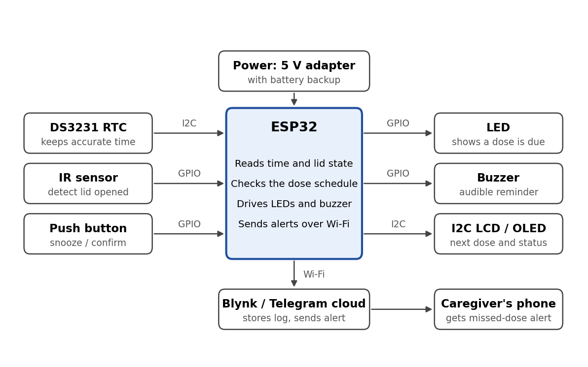

# 💊 Smart Medicine Reminder Box

**An IoT-enabled smart pillbox for elderly people living alone.**
An ESP32 reminds the user to take their medicine with light and sound, confirms the dose by detecting the lid opening, and alerts a family member through **Blynk** or **Telegram** when a dose is missed.


> **Disclaimer:** This is an academic prototype. It only reminds and reports. It does not dispense, identify, or recommend medicine, and it is **not a certified medical device**. The dose schedule must be entered by the caregiver as prescribed by a doctor.

---

## Table of Contents

- [Overview](#overview)
- [Features](#features)
- [System Architecture](#system-architecture)
- [How It Works](#how-it-works)
- [Hardware Components](#hardware-components)
- [Circuit Connections](#circuit-connections)
- [Software and Libraries](#software-and-libraries)
- [Getting Started](#getting-started)
- [Algorithm](#algorithm)
- [Testing](#testing)
- [Limitations](#limitations)
- [Future Scope](#future-scope)
- [Applications](#applications)
- [Project Team](#project-team)
- [References](#references)

---

## Overview

India has over 140 million people aged 60 and above, and a growing share of them live alone. Many take several tablets a day for conditions such as diabetes, hypertension, and heart disease. Missing a dose, doubling a dose, or mixing up tablets is common with age and can lead to serious health problems.

Traditional pill organisers store tablets but do not remind the user or inform anyone when a dose is skipped. Phone alarms are easy to silence and forget. This project combines an **embedded reminder** with **IoT connectivity** so that family, neighbours, and local caregivers can support an elderly person without being physically present.

**Gap addressed:** a low-cost, locally built pillbox that verifies the dose and informs caregivers over IoT, designed for people who may not be comfortable with smartphones.

| Existing solution | Limitation |
|---|---|
| Manual weekly pill organiser | No reminder, no monitoring |
| Phone alarm or calendar | Easy to dismiss, needs smartphone skills, no caregiver alert |
| Commercial smart pill dispensers | Expensive, imported, hard to repair |
| Basic timer pillboxes | No dose confirmation, no connectivity, no history |

## Features

- ⏰ **Timed reminders** for up to 3 doses per day (for example 08:00, 14:00, 20:00) with LED, buzzer, and display message
- 🕒 **Accurate timekeeping** with a DS3231 RTC that keeps time through power and Wi-Fi failures
- ✅ **Dose-taken confirmation** using an IR proximity sensor that detects the lid opening
- 🔁 **Retry and snooze**: the buzzer repeats during a grace window, and a push button silences it briefly
- 📲 **Missed-dose alerts** sent to the caregiver's phone via Blynk or a Telegram bot
- 🗂️ **Dose history logging** (Taken or Missed, with timestamp) for family or doctor review
- 📴 **Offline mode**: local reminders keep working without Wi-Fi, and events upload when the connection returns
- 🖥️ **Status display** showing the next dose time on an I2C LCD or OLED
- 💰 **Low cost**: core build under about Rs. 1,500

## System Architecture

)

The ESP32 stores the dose schedule, watches the clock and the lid sensor, and decides when to remind the user and when to alert the caregiver.

## How It Works

1. **Setup:** the caregiver enters the dose times through the Blynk app or directly in the code. Times are stored in the ESP32 flash memory.
2. **Timekeeping:** the DS3231 RTC supplies the current time over I2C. Its coin cell keeps time during a power cut, and it can be synced once from an NTP server when Wi-Fi is available.
3. **Reminder:** when the RTC time matches a dose time, the LED turns on, the buzzer beeps in a repeating pattern, and the display shows "Take Medicine".
4. **Confirmation:** when the user opens the lid, the IR sensor output changes state. The ESP32 stops the buzzer, switches off the LED, and records the dose as **Taken**.
5. **Retry and snooze:** if the lid is not opened, the buzzer repeats during a grace window (for example 15 minutes). The push button silences it for a short snooze.
6. **Missed dose:** when the grace window ends without a lid opening, the dose is marked **Missed** and a notification is sent to the caregiver.
7. **Logging:** every Taken or Missed event is uploaded with its timestamp.
8. **Offline mode:** if Wi-Fi is down, steps 1 to 5 still work locally, and events are stored and uploaded later.

**How the IR sensor works:** one IR obstacle sensor module is fixed on the box body, facing the underside of the lid. With the lid closed, the IR light reflects back and the output stays `LOW`. When the lid is lifted, the reflection is lost, the output goes `HIGH`, and the ESP32 reads this as "lid opened". Adjust the module's potentiometer so it detects only at a short range of about 2 to 4 cm, and keep the box away from direct sunlight, which can disturb IR sensors.

## Hardware Components

| Component | Qty | Role in the project | Approx. cost (Rs.) |
|---|---|---|---|
| ESP32 DevKit V1 | 1 | Main controller and IoT gateway | 450 |
| DS3231 RTC module (with CR2032) | 1 | Accurate timekeeping | 150 |
| IR obstacle sensor (FC-51 or TCRT5000) | 1 | Detects lid opening | 30 |
| 16x2 LCD with I2C backpack (or 0.96" OLED) | 1 | Displays next dose and status | 150 |
| LED, 5 mm, with 220 Ω resistor | 1 | Visual indication | 5 |
| Active buzzer (5 V) | 1 | Audible reminder | 20 |
| Push button | 1 | Snooze or manual confirm | 10 |
| BC547 NPN transistor with 1 kΩ resistor | 1 | Drives the buzzer from a GPIO pin | 10 |
| Single-compartment pill box | 1 | Enclosure for medicines | 100 |
| Perfboard, jumper wires, headers | 1 set | Circuit assembly | 120 |
| 5 V 2 A adapter with micro-USB cable | 1 | Main power | 150 |
| TP4056 charger module with 18650 cell *(optional)* | 1 | Battery backup during power cut | 250 |

**Total:** about **Rs. 1,195** without battery backup and **Rs. 1,445** with it. Prices are approximate Indian market estimates and vary by seller.

**Why ESP32 and not Arduino Uno?** The ESP32 has Wi-Fi built in, so no separate ESP8266 or GSM module is needed. It also has enough GPIO pins and runs at 3.3 V, which matches the RTC and display modules.

## Circuit Connections

Suggested pin mapping for an **ESP32 DevKit V1**. Confirm against your own board's pinout before wiring.

| Module | Module pin | ESP32 pin | Note |
|---|---|---|---|
| DS3231 RTC | SDA | GPIO 21 | I2C data, shared with the display |
| DS3231 RTC | SCL | GPIO 22 | I2C clock, shared with the display |
| DS3231 RTC | VCC, GND | 3.3 V, GND | Power |
| I2C LCD or OLED | SDA, SCL | GPIO 21, GPIO 22 | Same I2C bus, different address |
| I2C LCD or OLED | VCC, GND | 5 V (LCD) or 3.3 V (OLED), GND | Check the module rating |
| IR sensor | OUT | GPIO 32 | VCC to 3.3 V, GND to GND |
| LED | Anode via 220 Ω | GPIO 13 | Cathode to GND |
| Buzzer | Positive | 5 V | Negative to collector of BC547 |
| BC547 transistor | Base via 1 kΩ | GPIO 17 | Emitter to GND |
| Push button | One end | GPIO 4 | Other end to GND, uses `INPUT_PULLUP` |

## Software and Libraries

- **Arduino IDE** with the ESP32 board package
- **RTClib** for the DS3231
- **LiquidCrystal_I2C** for the display
- **WiFi.h** for connectivity
- **Blynk IoT** or **UniversalTelegramBot** for caregiver alerts
- **Fritzing** or **Tinkercad** for circuit diagrams

## Getting Started

### Prerequisites

- Arduino IDE with the ESP32 board package installed
- The libraries listed above (install through the Library Manager)
- A Blynk account or a Telegram bot token for alerts
- Wi-Fi credentials for your home network

### Installation

1. **Clone the repository**
   ```bash
   git clone https://github.com/<your-username>/<your-repo-name>.git
   cd <your-repo-name>
   ```
2. **Assemble the hardware** following the [circuit connections](#circuit-connections).
3. **Open the sketch** in the Arduino IDE and select the board **ESP32 Dev Module**.
4. **Configure the schedule** in the code (up to 3 doses per day):
   ```cpp
   const int doseHour[NUM] = {8, 14, 20};
   const int doseMin[NUM]  = {0, 0, 0};
   ```
5. **Add your Wi-Fi and alert credentials** (Blynk token or Telegram bot token and chat ID) and complete the `sendAlert()` function.
6. **Upload** the sketch to the ESP32 and open the Serial Monitor at `115200` baud.
7. **Calibrate the IR sensor** using its potentiometer until the Serial Monitor shows a clean state change at about 2 to 4 cm.

> **Note:** the program in this repository is a working skeleton to build on, not a fully tested final program. Add your credentials and the Blynk or Telegram call inside `sendAlert()`. Never commit real credentials to a public repository. Keep them in a separate `secrets.h` file listed in `.gitignore`.

## Algorithm

1. Initialise the I2C bus, RTC, display, GPIO pins, and Wi-Fi.
2. Read the current time from the RTC. At midnight, clear the "done today" flags.
3. Check whether the current time equals any scheduled dose time that is not yet done.
4. If yes, switch on the LED, show the message, and start the buzzer pattern and the grace timer.
5. While the reminder is active, read the IR sensor. If the lid is opened, stop the alarm, mark the dose **Taken**, and log it.
6. If the grace timer expires with no lid opening, stop the alarm, mark the dose **Missed**, and send the caregiver alert.
7. If the push button is pressed, silence the buzzer for the snooze period.
8. Repeat from step 2.

**Design notes:**
- `millis()` is used instead of `delay()` so the ESP32 keeps reading sensors while the buzzer beeps.
- An external RTC is used instead of the ESP32's internal clock because it keeps accurate time through power cuts.

## Testing

| Test case | Condition | Expected result |
|---|---|---|
| Time accuracy | Run the RTC for 24 hours and compare with phone time | Drift of a few seconds or less |
| Scheduled reminder | RTC time reaches a dose time | LED on, buzzer beeps, message shown |
| Dose taken | Open the lid during the reminder | Alarm stops, status becomes Taken, event logged |
| Missed dose | Ignore the reminder for the grace period | Status becomes Missed, caregiver notified |
| Snooze | Press the button during the alarm | Buzzer silent for snooze time, then resumes |
| Power cut | Disconnect the main supply | RTC keeps time, device resumes on power restore |
| Wi-Fi failure | Switch off the router | Local reminders work, events uploaded later |

## Limitations

- The IR sensor confirms that the **lid was opened**, not that the tablet was swallowed.
- One compartment holds all doses, the user must load it correctly, and the device does not identify tablets.
- Remote alerts need a Wi-Fi connection.
- If the lid is already open when a reminder starts, the sensor reads "opened" and the dose is logged as taken straight away.
- It does not dispense medicine automatically and is not a certified medical device.

## Future Scope

- Load cell under the compartment to confirm that tablets were actually removed
- GSM module for SMS alerts in areas without Wi-Fi
- Voice prompts in the local language using a DFPlayer Mini
- Stock monitoring that warns the caregiver when medicine is running low
- Mobile app with adherence reports for doctors, and a rechargeable battery with low-battery alert
- Multi-compartment version with separate LEDs and sensors, and servo-based automatic dispensing

## Applications

- Homes of elderly people living alone, or with a caregiver who works during the day
- Old-age homes and community health centres managing many residents' medicines
- Patients with chronic diseases such as diabetes, hypertension, and tuberculosis
- Post-surgery recovery at home

## Project Team

IoT Mini Project, S.Y. Electronics and Computer Science, Academic Year 2026-2027
**Thakur Shree DPS College of Engineering and Management**

| Name |
|---|
| Shlok Bharat Bhadrike |
| Sameer Chaudhary |
| Parth Mewada |
| Rishit Soni |

**Project guide:** Mr. Rahul Dhuru

## References

1. Maxim Integrated, *DS3231 Extremely Accurate I2C-Integrated RTC/TCXO/Crystal*, datasheet.
2. Espressif Systems, *ESP32 Series Datasheet* and *ESP32 Technical Reference Manual*.
3. World Health Organization, *Adherence to Long-Term Therapies: Evidence for Action*, 2003.
4. Official documentation for the Arduino core for ESP32, RTClib, LiquidCrystal_I2C, and Blynk IoT.

## License

Add a license of your choice (for example MIT) in a `LICENSE` file.

